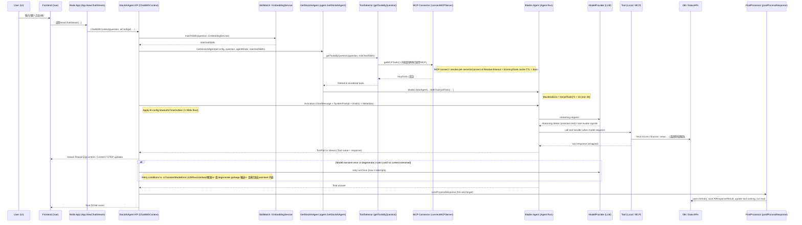
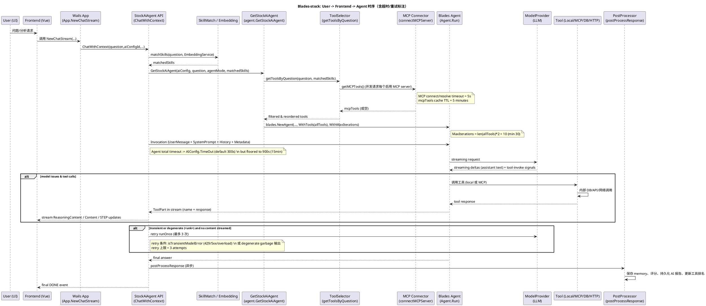
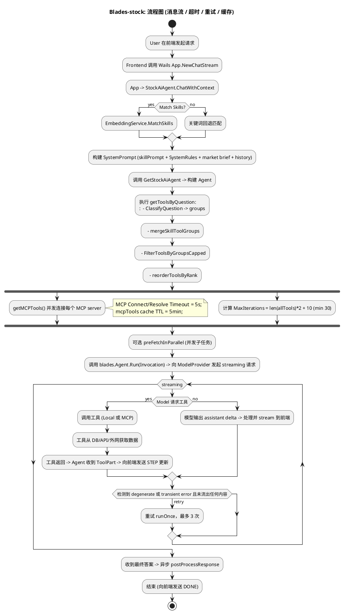

# Blades-Stock Agent 核心时序与运行时约束架构规范

本文档详尽记录了 `blades-stock` 系统中 Agent 调用链的完整生命周期、时序交互、消息流转拓扑、关键超时/重试约束点以及代码锚点，方便开发调试、性能优化与生产排障。

---

## 1. 运行时约束与弹性控制矩阵 (Runtime Constraints Matrix)

| 约束维度 | 关键参数 / 规则 | 对应代码位置 | 默认阈值 / 行为 | 设计目的与防范风险 |
| :--- | :--- | :--- | :--- | :--- |
| **会话总超时** | `TimeOutSec` (Session Context) | `backend/agent/agent_api.go` | `max(AIConfig.TimeOut, 900s)` | 兜底长时思考（Thinking 模式）与多轮工具调用，防长任务过早夭折；防死锁挂起 |
| **工具迭代步数** | `WithMaxIterations` | `backend/agent/agent.go` | `max(len(tools)*2 + 10, 30)` | 彻底杜绝 LLM 在复杂多工具编排中陷入死循环无限调用；保证推理预算收敛 |
| **MCP 建连超时** | `Connect(ctx, 5s)` | `backend/agent/agent.go` | `5 秒` | 防止外部 MCP 进程僵死或网络不可达时阻塞 Agent 启动主流程 |
| **MCP 解析超时** | `Resolve(ctx, 5s)` | `backend/agent/agent.go` | `5 秒` | 防止大型 MCP Server 工具列表拉取过慢阻塞会话 |
| **MCP 工具缓存** | `mcpToolsCache` | `backend/agent/agent.go` | `TTL = 5 分钟` | 避免每次用户提问都重新协商 MCP 工具 schema，消除毫秒级重复握手开销 |
| **瞬时故障重试** | `maxAttempts` (Backoff Retry) | `backend/agent/agent_api.go` | `最多 3 次` (指数退避) | 针对 `429`, `5xx`, `unexpected end of JSON input`, `EOF` 进行重试（仅在首包未流出时触发） |
| **多模型热降级** | `FallbackModelProvider` | `backend/agent/fallback_provider.go` | 自动依次切换备用模型 | 主模型在流式首包断流/崩溃时，基于 `iter.Seq2` 透明切换至备用模型输出 |
| **乱码检测熔断** | `IsDegenerateGarbage` | `backend/agent/agent_api.go` | 抛出 `DegenerateOutputError` | 识别模型输出大量 `<unk>` 重复乱码流，立即熔断当前生成并触发退避重试 |
| **工具入参安全** | `Param Defensive Sanitizer` | `backend/agent/tools/*` | 空串转 `"{}"`，不抛中断 Error | 防范 LLM 偶发生成空 JSON 引发反序列化失败导致 Agent 崩溃 |
| **异步后处理** | `postProcessResponse` | `backend/agent/agent_api.go` | `sync.WaitGroup` + 独立 `recover` | 记忆入库、自反思打分、工具权重进化与研报沉淀完全异步，零阻塞前端交互响应 |

---

## 2. 交互时序图 (Sequence Diagrams)

### 2.1 Mermaid 版本


### 2.2 PlantUML 版本


---

## 3. 消息流与决策状态机 (Flowcharts)

### 3.1 Mermaid 流程图
```mermaid
flowchart TD
  A[User 用户发起请求 (Frontend)] --> B[Wails 桥接入口 (NewChatStream)]
  B --> C[StockAiAgent.ChatWithContext]
  
  C --> D{是否开启 Embedding 匹配?}
  D -->|是| E[EmbeddingService.MatchSkills 向量匹配]
  D -->|否/降级| F[Keyword Fallback 关键字匹配]
  
  E --> G[构建 System Prompt\n(SkillPrompt + SystemRules + GlobalSensor + MarketBrief)]
  F --> G
  
  G --> H[GetStockAiAgent -> 构建 Agent 实例]
  H --> I[getToolsByQuestion 按需路由工具]
  
  I --> J[tools.ClassifyQuestion 问题意图分类]
  I --> K[mergeSkillToolGroups 强合并 Skill 工具组]
  J --> L[FilterToolsByGroupsCapped 截断筛选]
  K --> L
  L --> L2[reorderToolsByRank 历史成功率重排]
  
  I --> M[getMCPTools 并发获取 MCP 工具 (缓存 5min)]
  M -->|遍历已启用 MCP 服务| N[connectMCPServer]
  N -->|stdio / HTTP| O[NewClient + Connect 5s + Resolve 5s]
  O --> M
  
  L2 --> P[创建 blades.Agent\n(注入 ModelProvider / Middleware / MaxIterations)]
  M --> P
  
  P --> Q[preFetchInParallel 并发预采集数据]
  Q --> R[blades.Agent.Run 核心流式运行]
  
  R --> S[ModelProvider 流式生成]
  S -->|工具调用请求| T[Tool Handler (Local 或 MCP)]
  T --> U[底层数据源 (Data APIs / DB / External HTTP)]
  U --> T
  T --> R
  
  R --> V{是否触发乱码或瞬时错误?}
  V -->|是 且 无流出文本| W[runOnce 退避重试 (最多 3 次)]
  W --> R
  V -->|否 (正常响应)| X[实时推送 StreamMessage 至前端]
  
  X --> Y[postProcessResponse 异步后处理]
  Y --> Z[持久化记忆 + 结果自反思评估 + 智能研报落库 + 工具权重进化]

  subgraph Guardians [🛡️ 关键保护哨兵]
    TimeoutNote["⏱️ 会话超时: TimeOutSec (下限 900s)"]
    MaxIterNote["🔄 迭代防爆: MaxIterations = len(tools)*2 + 10 (下限 30)"]
    MCPTimeoutNote["🔌 MCP 哨兵: Connect/Resolve 双 5s 超时, 缓存 TTL=5min"]
    RetryNote["🔁 重试哨兵: 瞬时故障 (429/5xx/断流/截断) 重试 <= 3 次"]
  end

  C -.-> TimeoutNote
  P -.-> MaxIterNote
  O -.-> MCPTimeoutNote
  W -.-> RetryNote
```

### 3.2 PlantUML 流程图


---

## 4. 关键代码映射表

- **Wails App 绑定入口**：`app.go` -> `NewChatStream(...)`
- **Agent 流式调度入口**：`backend/agent/agent_api.go` -> `ChatWithContext(...)`
- **技能语义匹配与提示词生成**：`backend/agent/agent.go` -> `matchSkills(...)` / `BuildShortSkillPrompt(...)`
- **Agent 工厂构建与中间件配置**：`backend/agent/agent.go` -> `GetStockAiAgent(...)`
- **工具意图分类与过滤**：`backend/agent/agent.go` -> `getToolsByQuestion(...)` / `backend/agent/tools/tool_groups_config.go`
- **MCP 连接协商与白名单**：`backend/agent/agent.go` -> `connectMCPServer(...)` / `getMCPTools(...)`
- **多模型流式降级**：`backend/agent/fallback_provider.go` -> `FallbackModelProvider.NewStreaming(...)`
- **执行循环与瞬时故障判定**：`backend/agent/agent_api.go` -> `runOnce(...)` / `isTransientModelError(...)`
- **异步闭环后处理**：`backend/agent/agent_api.go` -> `postProcessResponse(...)`
- **股票推荐沉淀管道**：`backend/agent/recommend_extractor.go` -> `ExtractAndSaveRecommendationsFromReport(...)`
